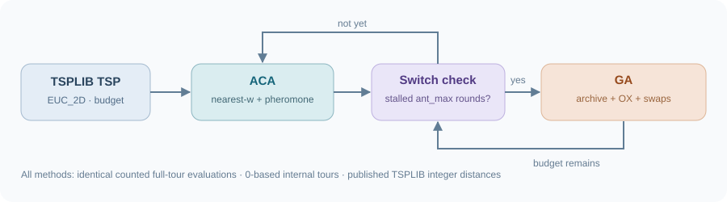
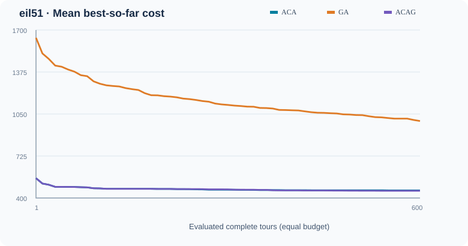
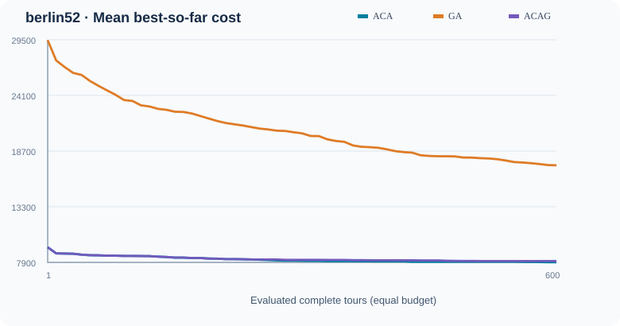
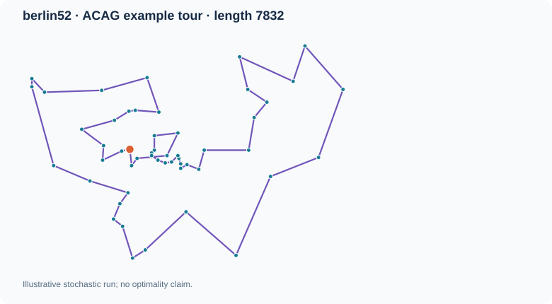

# ACAG-Repro · Ant Colony + Genetic Algorithm for TSP

[](https://github.com/ZJY-HSBL/ACAG-Repro/actions/workflows/release.yml)
[](https://github.com/ZJY-HSBL/ACAG-Repro/releases)

**English** | [简体中文](#中文说明)

A transparent, budget-controlled reproduction **in progress** of the 2022 paper by Wen-shun Sheng, Ai-ping Xu, and Liu-jing Xu, *Simulation of Traveling Salesman Path Planning Based on Ant Colony Algorithm and Genetic Algorithm*, *Computer Simulation*, 39(12), pp. 398–402.

> **Scientific status (v0.1.0):** This is an independently implemented **paper-inspired baseline**, **not** an exact or confirmed replication of the paper's reported superiority. Several implementation choices were unspecified in the article. They are documented below. Results are generated by this code, not copied from the paper.

## Concept



1. **ACA:** construct city permutations with a nearest-`w` candidate list, ACS-style exploitation (`q < q0`) / roulette exploration, per-edge local pheromone adjustment, and iteration-best global reinforcement.
2. **ACA → GA:** when improvement has been below `min_ratio` for `ant_max` consecutive generations, switch to GA if a function-evaluation budget remains. Preserve distinct strong ACA tours to seed the GA population.
3. **GA:** permutation encoding, reciprocal route-length fitness, roulette selection, Davis OX crossover, and a random-segment improving adjacent-swap mutation.

For the TSP, the objective is a **closed cycle** (including the return edge). The TSPLIB `EUC_2D` distance convention is `floor(Euclidean distance + 0.5)`; ordinary floating-point Euclidean costs are **not** interchangeable with published TSPLIB values.

## Quick start

Requires Python 3.10+; solver has **zero runtime dependencies**.

```bash
python -m pip install -e '.[test]'
python acag.py data/eil51.tsp --algorithm acag --seed 42 --budget 600 --out results/local/run.json
python acag.py data/berlin52.tsp --algorithm aca --seed 42 --budget 600
python -m pytest -q
python tools/benchmark.py --seeds 10 --budget 600 --population 20
```

`--budget` counts **evaluated complete tours**, not generations; all methods have the same budget. GA population initialization counts against this budget. For the hybrid, ACA archive members are not re-evaluated upon switching, so previously evaluated candidate tours do not artificially increase the budget. Wall time and path evaluations should both be assessed in future studies.

## Real experimental results (v0.1.0, exploratory)

The repository includes real, deterministic output from **10 paired seeds (0–9)** per method on two TSPLIB problems, with **600 complete-tour evaluations**, population 20, Python standard-library PRNG and common seed IDs. This is a pilot experiment, **not** a statistically convincing replication of the published experimental setup.

| Instance (known optimum) | ACA mean | GA mean | ACAG mean | ACAG best observed |
|---|---:|---:|---:|---:|
| eil51 (426) | 458.9 | 995.6 | **455.5** | 444 |
| berlin52 (7542) | **7916.1** | 17315.4 | 8028.8 | 7832 |







The **paired mean difference** (ACAG − ACA; lower favors ACAG) is **−3.4** on eil51 and **+112.7** on berlin52. Exploratory paired t-based 95% intervals: eil51 **[−12.8, +6.0]**, berlin52 **[+32.5, +192.9]**. These intervals are unadjusted, assume seed-pair differences behave suitably for a t interval, and should not be overinterpreted with n=10.

**Interpretation:** the present implementation has not established an ACAG advantage over the ACA baseline; it is worse on berlin52 under this test budget. Pure GA is much worse with the deliberately minimal local mutation and a random initial population. This is a limitation of *this implementation and protocol*, not evidence against the original paper's results. More robust GA variants and equal-wall-clock comparisons are needed. Do not conflate best-observed solutions with proof of global optimality.

The raw seed-level results are in [`results/benchmark_v0.1.0.csv`](results/benchmark_v0.1.0.csv), with machine-readable summary in [`results/summary_v0.1.0.json`](results/summary_v0.1.0.json). Re-run `python tools/benchmark.py` to regenerate the SVG figures and files, then inspect differences with `git diff`.

## Paper details and reproduction limits

The article provides the nearest-neighbor candidate policy, modified local pheromone update (equation 6), iteration-best reinforcement (equation 7), OX crossover and segment swap, but **does not provide source code, initial pheromone details, all per-instance settings, or an unambiguous GA population management policy**. Its section 3 also uses inconsistent switch-threshold labels (`Ant min-ratio` and `Ant max-ratio`). The publication reports approximate results on berlin52, d198 and lin318; they are **not reproduced claims** here.

Explicit version-0.1 implementation decisions:

- The switch criterion is `ant_max` consecutive ACA rounds without a **relative incumbent improvement of at least `min_ratio`**, using `min_ratio=0.01`, `ant_max=8` by default. This operationalizes, but is not uniquely dictated by, the paper.
- The ACA archive retains **distinct (rotation/reversal-normalized)** tours ranked by quality. The paper describes a replacement-based 2D chromosome array; that strategy is not uniquely specified enough for exact reconstruction.
- GA adds **elitist survivor selection and deduplication** to avoid losing the incumbent; neither is stated as mandatory in the paper. This makes the implementation **not bit-for-bit identical** to the published method.
- Equation (6) can produce negative pheromone values; entries are floored to `1e-12` for valid transition probabilities, and updates are symmetric. Local updates also use the current-edge distance with a floor to handle coincident coordinates.
- For fair budgets, an ACA generation may have fewer than `population` ants at the final budget remainder; GA offspring generation may likewise be partial.
- Default parameter values, especially `ant_max`, are **not the specific per-instance tuned settings** of the paper. This first release deliberately favors reproducible common settings over per-instance tuning.

**Next research milestone:** implement `paper-parameter` and `controlled-ablation` presets; add d198, lin318 and pr107 data where distribution terms permit; evaluate ≥30 new paired seeds at several budgets; add no-switch, no-greedy, no-archive, and alternative switch criteria ablations; compare cost per evaluation and elapsed runtime; report multiplicity-aware uncertainty and preregistered hold-out instances. Improve GA without attributing unfair baseline handicaps to the original method.

## Files and release management

- `acag.py`: TSP reader, permutation operators, ACA/GA/ACAG solvers and CLI.
- `tools/benchmark.py`: paired-seed experiments and reproducible SVG/CSV/JSON output.
- `data/`: compact, attributable TSPLIB instances (`eil51`, `berlin52`). Data is sourced from TSPLIB mirrors; original problem authors retain their respective rights.
- `tests/`: parser, operator, determinism, budget and switch unit tests.
- `.github/workflows/release.yml`: CI. Following successful test and reproducibility checks, creates the immutable-named `v0.1.0` GitHub Release on its first main-branch run (if repository Actions permissions allow).

TSPLIB data references: [eil51 mirror](https://github.com/mastqe/tsplib/blob/master/eil51.tsp) · [berlin52 mirror](https://github.com/pdrozdowski/TSPLib.Net/blob/master/TSPLIB95/tsp/berlin52.tsp).

---

## 中文说明

本仓库以圣文顺、徐爱萍、徐刘晶（2022）《基于蚁群算法与遗传算法的 TSP 路径规划仿真》为对象，研究论文提出的 **ACAG：近邻贪心蚁群算法 + 停滞触发的动态切换 + 遗传算法**。

**v0.1.0 的定位是可运行、可复验的第一阶段复现，而不是已证明严格复现论文的所有实验结论。** 对论文未详细说明的切换阈值、种群更新、信息素非负性与精英保留等问题，仓库采用了明确、可测试的工程定义，并逐条记录。

使用方法：

```bash
python -m pip install -e '.[test]'
python acag.py data/eil51.tsp --algorithm acag --seed 42 --budget 600
python tools/benchmark.py --seeds 10 --budget 600
python -m pytest -q
```

**首轮结论：**在相同的完整路径评价次数下，ACAG 在 eil51 的平均路径长度为 455.5，ACA 为 458.9；但在 berlin52 中，ACAG 为 8028.8，ACA 为 7916.1，当前不能证明混合策略存在稳定增益。请结合上述两张收敛 SVG、路径可视化图、逐种子 CSV 和统计不确定性共同分析，而非仅选取一次最好结果。

**下一阶段重点**是公平对照、消融实验、独立随机种子和不同实例上的泛化性能，避免通过对测试实例反复调参制造虚假的性能优势。项目使用 GitHub Releases 管理正式版本，实验结果应随每次发布一同更新。
