# ACAG-Repro | ACA–GA Hybrid TSP Reproduction

[](https://github.com/ZJY-HSBL/ACAG-Repro/actions/workflows/release.yml)
[](https://github.com/ZJY-HSBL/ACAG-Repro/releases)

[**English**](#english) · [**简体中文**](#中文说明) · [**Research evidence**](results/) · [**Releases**](https://github.com/ZJY-HSBL/ACAG-Repro/releases)

<a id="english"></a>

## English

A transparent, budget-controlled **research reproduction in progress** of the ACAG hybrid in Sheng, Xu & Xu (2022), *Simulation of Traveling Salesman Path Planning Based on Ant Colony Algorithm and Genetic Algorithm*, *Computer Simulation* 39(12), 398–402. This is a **paper-inspired implementation with documented deviations**, not a claim of exact numerical replication.

**v0.3.0 research verdict:** *2-opt is useful only when applied at an appropriate phase; a stronger GA mutation alone has not established an advantage over ACA.* In a 12-seed exploratory pilot, ACA at 75% budget followed by 2-opt produced a modest improvement on both tested datasets. The ACAG 75%-switch 2-opt variant was slightly better than ACA on `berlin52`, but its paired interval includes zero. These are **method-development results**, not statistically confirmed superiority or unseen-instance generalization. Earlier results and caveats remain below.

### Algorithm


- **ACA:** fixed-size nearest-neighbor candidate list, exploitation / roulette-based exploration, local pheromone adjustment, iteration-best global deposit.
- **Transfer:** populate GA with the distinct strongest ACA tours from its evaluation archive. The paper's exact archive-replacement strategy is underspecified.
- **GA:** permutation chromosomes, reciprocal-length fitness, order crossover (OX), improving adjacent-swap segment local search, and elitist survivor selection. Elitism/deduplication are explicit engineering choices rather than claimed original requirements.
- **Ablations:** adaptive stagnation switch; switch after 25%, 50%, or 75% of budget; 50%-switch with **random** GA initial population; no-switch ACA and separate GA baselines.

The objective is a **closed Euclidean TSP tour** with TSPLIB integer `EUC_2D` edge weights (`floor(Euclidean distance + 0.5)`), including the last-to-first return edge. Supported datasets are `eil51` and `berlin52`.

### v0.3.0 — Does GA-stage 2-opt add value beyond ACA?

**Experimental status: exploratory screening, not confirmatory validation.** `v0.3.0` adds a *charged*, stochastic **2-opt** (tour segment reversal) operator, an **ACA+2opt** baseline (local-search trials applied to each ant tour), a stronger **ACA75-polish** control (first 75% ACA, remaining budget pure 2-opt on the best tour), and hybrid variants with/without **elite feedback** (GA-stage incumbent refinements are transferred back into the GA population). Original OX/adjacent-swap remains available and unchanged by default. The two-opt mutation, elite feedback, and 75% polishing are **our extensions**, not described in the 2022 article.

**Protocol:** `eil51` and `berlin52` × 12 new paired seeds `200–211` × 11 treatments = **264 independently executed optimization trials**. Every treatment receives **1,000 measured full-tour objective evaluations**, including rejected 2-opt proposals. The local 2-opt trial cap is eight proposals per mutation, and the elite-refinement probability is 0.5 where enabled. All results are archived per seed and validated against the final tour. The datasets have already been examined during prior development, therefore these are **not holdout benchmarks**.

| Treatment (mean tour length ↓) | eil51 | berlin52 |
|:--|--:|--:|
| **ACA baseline** | 448.33 | 7,890.75 |
| ACA+2opt (every ant tour) | 471.42 | 8,614.00 |
| ACA75-polish (no GA) | **445.92** | 7,882.17 |
| GA adjacent-swap | 1,166.83 | 20,850.17 |
| GA 2-opt | 1,056.33 | 19,069.33 |
| ACAG 50% adjacent-swap | 452.08 | 7,913.75 |
| ACAG 50% 2-opt | 451.33 | 7,895.17 |
| ACAG 75% 2-opt | 447.50 | **7,856.00** |
| ACAG stagnation 2-opt | 457.75 | 7,955.50 |
| ACAG 50% 2-opt + elite feedback | 450.25 | 7,872.00 |
| ACAG 75% 2-opt + elite feedback | 448.33 | 7,873.42 |

The best observed mean (within this exploratory candidate set) differs by instance: **ACA75-polish on eil51**, **ACAG75-2opt on berlin52**. Crucially, for `berlin52`, `ACAG75-2opt − ACA` averages **−34.75**, with paired 95% bootstrap **[−82.17, +0.42]**; the interval crosses zero. For `eil51`, `ACA75-polish − ACA` averages **−2.42**, with unadjusted bootstrap **[−5.00, −0.25]**, but a family-wise Holm-corrected paired randomization result does **not** establish significance across the tested comparisons. We neither cherry-pick a single benchmark winner nor claim the GA hybrid is validated.

**Key causal insight:** Running 2-opt on *each newly created ant tour* reduces the number of ant-construction steps and performs worse than ACA. Spending the last 25% of budget polishing the *best ACA tour*, even without GA, is competitive. Consequently any purported hybrid improvement must beat **both** ACA and ACA75-polish under identical objective and wall-clock budgets, not just a weak baseline. Stronger mutation alone does not automatically repair the ACA→GA handoff.

**Zoomed known-optimum gaps** (GA outliers excluded from the zoom; see summary SVGs for all treatments):

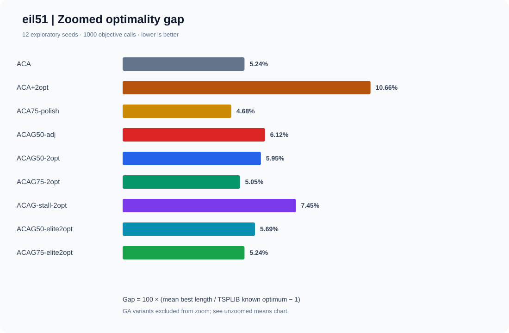
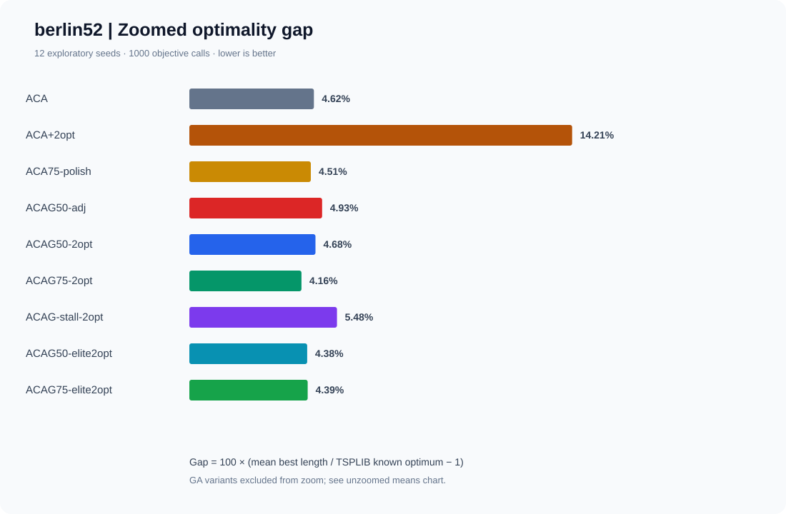

**Paired treatment − ACA effects (negative favors treatment; exploratory bootstrap 95% intervals):**

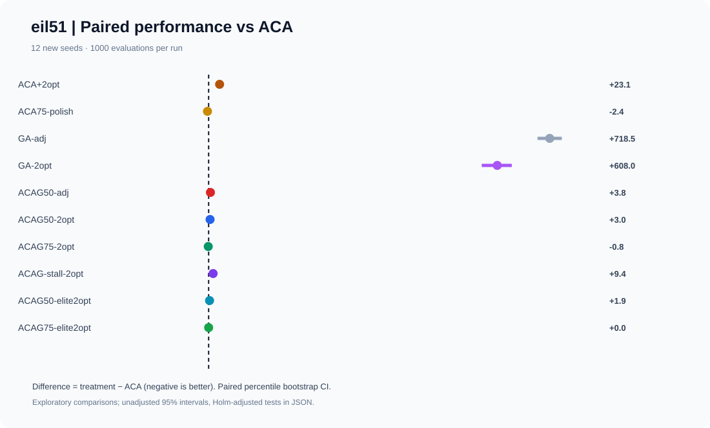
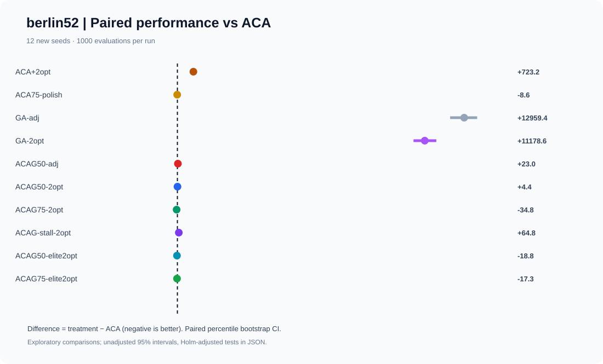

**Convergence indexed by fully charged objective calls:**

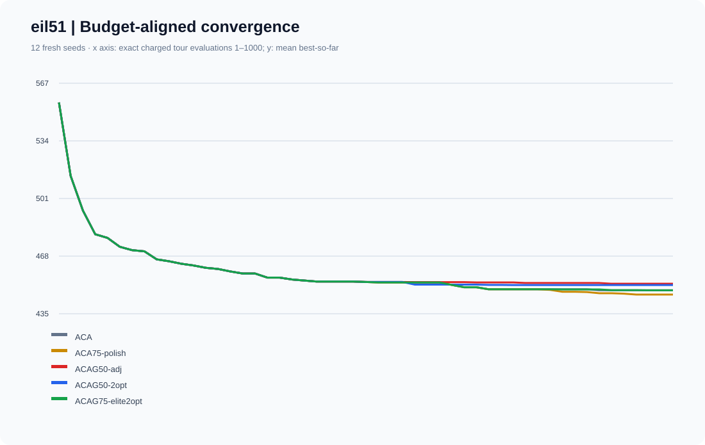
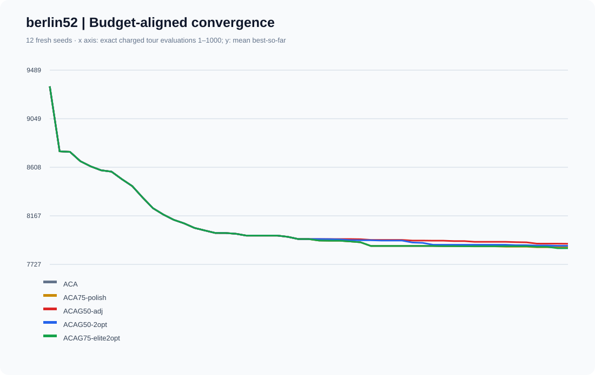

[All ten v0.3 SVGs](docs/figures/v0.3.0/) · [264 raw trial records](results/ablation_v0.3.0.csv) · [per-evaluation trajectories](results/convergence_v0.3.0.csv) · [paired statistics and Holm corrections](results/summary_v0.3.0.json).

Next: **freeze a candidate and validate it on genuinely unused TSPLIB instances**, report wall-clock and implementation-sensitive costs as well as evaluation budgets, increase seed count and control for multiple comparisons. Do not choose a 'successful' variant post hoc and report exploratory results as confirmatory. A 12-seed experiment is a development-screening stage only.

### Main scientific correction in v0.2.0

v0.1.0 charged **one evaluation per GA offspring**, yet the improving adjacent-swap mutation internally compared multiple candidate tours without counting them. Consequently the old “600 equal evaluations” claim was **not correct for full objective queries**.

In v0.2.0, **every evaluation of a complete tour, including each local-search candidate, consumes exactly one budget unit**. Previously evaluated ACA archive tours remain available for GA transfer without repeating their objective evaluation. Each v0.2.0 trial uses **1,000 full-tour objective evaluations**, including GA initialization and mutation, with a common population capacity of 20. The old v0.1.0 evidence is preserved as a historical exploratory artifact and **must not be compared across versions as an apples-to-apples algorithm change**.

### v0.2.0 experiments — 30 new paired seeds

Two TSPLIB benchmarks × seeds **100–129** × seven treatments = **420 complete optimization runs**. All treatments use 1,000 charged objective evaluations per run; lower path length is better. The instances are reused during method development, so **all findings remain exploratory**.

| Treatment | eil51 mean (optimum 426) | berlin52 mean (optimum 7542) |
|:--|--:|--:|
| **ACA baseline** | **451.37** | **7,857.17** |
| GA baseline | 1,169.93 | 21,117.67 |
| ACAG stagnation-triggered | 460.30 | 8,045.60 |
| ACAG switch at 25% budget | 460.93 | 8,092.10 |
| ACAG switch at 50% budget | 457.83 | 7,919.60 |
| ACAG switch at 75% budget | 455.03 | 7,892.90 |
| ACAG switch at 50%, random GA population | 460.43 | 7,969.07 |

**Gap-to-optimum comparison (zoomed to ACA/ACAG):**

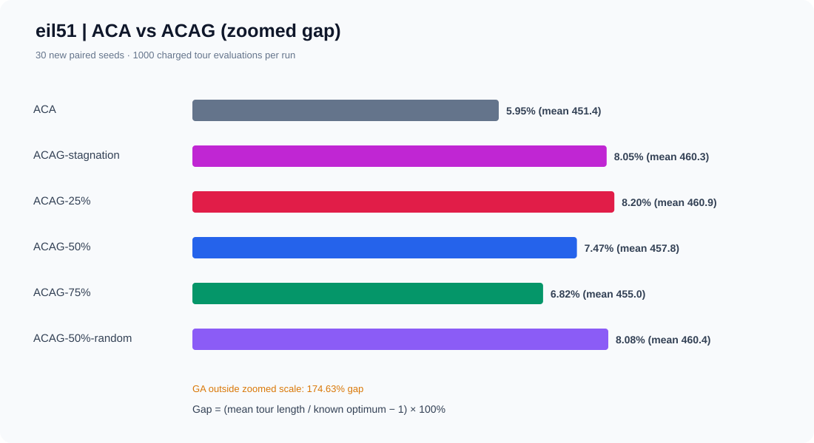

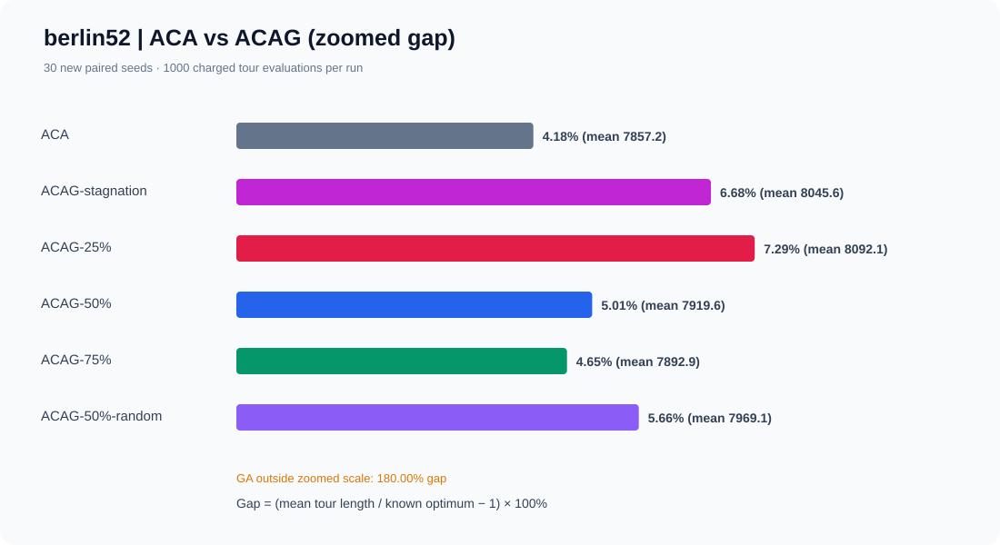

**Paired differences vs ACA with exploratory bootstrap 95% intervals (negative is better):**

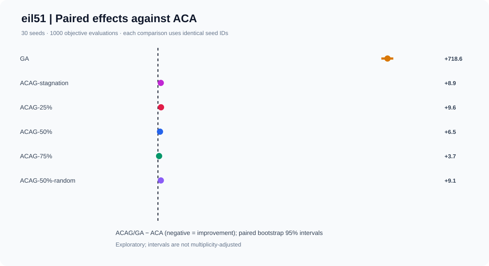

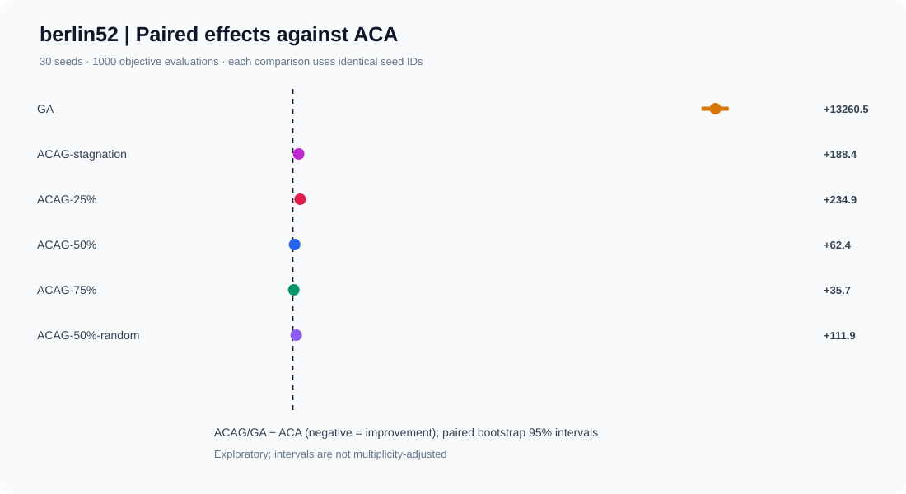

**Mean best-so-far curves, indexed by the same charged evaluation budget:**

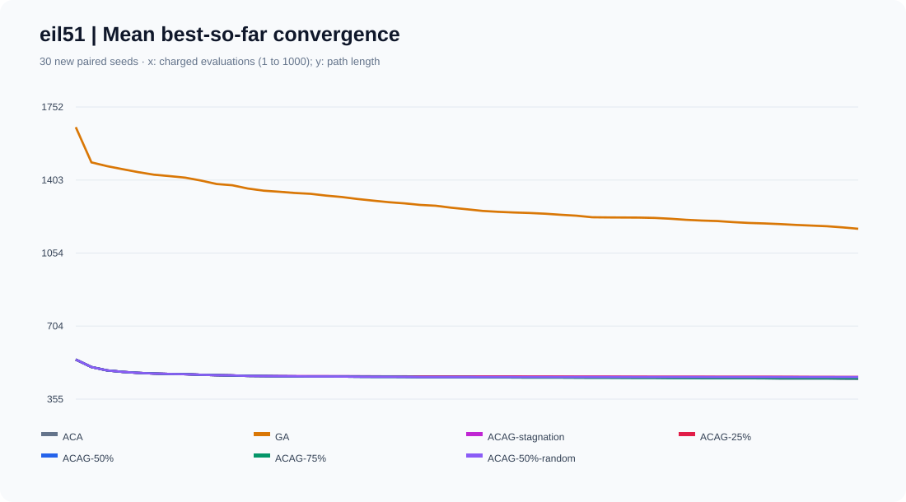

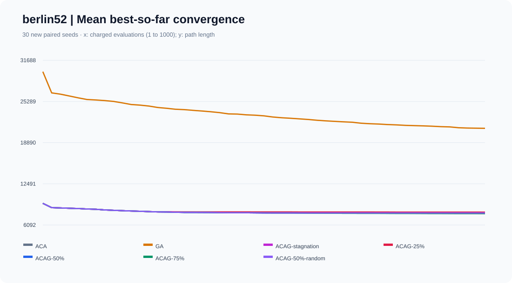

Key observations:

1. **Early ACA→GA handoff loses ground.** Relative to ACA, stagnation-triggered ACAG increases mean length by **+8.93 on eil51** and **+188.43 on berlin52**. Its paired bootstrap 95% intervals are **[+5.2, +12.9]** and **[+123.9, +257.8]**, respectively.
2. **Later switching is less harmful but is still not an improvement.** At the 75% point, ACAG minus ACA is **+3.67** on eil51 (bootstrap interval **[+1.1, +6.6]**) and **+35.73** on berlin52 (**[+5.3, +71.9]**).
3. **ACA-derived chromosomes are useful but insufficient.** At a 50% switch, random initialization is worse than archive transfer by **+2.60** (eil51) and **+49.47** (berlin52) in matched seeds. These contrasts are descriptive, not yet independently confirmed.
4. **Pure GA is weak under this particular operator set.** Even when internal mutation trials are counted, OX plus adjacent-swap hill climbing is unable to match the strong ACA construction stage here. These GA results should not be generalized to modern, tuned genetic TSP solvers.
5. **No empirical evidence yet supports ACAG's superiority on unseen instances.** Multiple intervals and Holm-adjusted sign-flip Monte Carlo test results are archived, but repeated examination of the same two problems can bias method selection. No confirmatory claim is made.

This changes the next research question: **Does stronger yet evaluation-budgeted GA local search or a bidirectional pheromone/genotype feedback mechanism add anything over simply spending all the budget on ACA?** Future work should first run a *separately scoped* operator ablation, then freeze the chosen method and test it on unseen TSPLIB instances, with multi-budget and wall-clock comparisons. Do not retrofit the post-hoc winner into a “validated” method.

### Reproduce

Python 3.10+; the solver and SVG-producing experiment scripts have no third-party runtime requirements. `pytest` is used only for tests.

```bash
python -m pip install -e '.[test]'
python -m pytest -q
python acag.py data/eil51.tsp --algorithm acag --budget 1000 --switch-policy fixed75 --seed 100
python acag.py data/berlin52.tsp --algorithm acag --budget 1000 --switch-policy fixed50 --transfer-policy random --seed 101
python tools/ablation_v02.py --seed-start 100 --seeds 30 --budget 1000 --population 20
python acag.py data/eil51.tsp --algorithm acag --mutation-policy 2opt --switch-policy fixed75 --budget 1000 --seed 200
python acag.py data/berlin52.tsp --algorithm aca_polish --switch-policy fixed75 --budget 1000 --seed 200
python tools/ablation_v03.py --seed-start 200 --seeds 12 --budget 1000 --population 20 --two-opt-trials 8
```

`tools/ablation_v02.py` deterministically regenerates [per-run outcomes](results/ablation_v0.2.0.csv), [mean convergence checkpoints](results/convergence_v0.2.0.csv), [JSON statistics](results/summary_v0.2.0.json), and six [SVG figures](docs/figures/v0.2.0/). Bootstrap intervals use 8,000 resamples; paired sign-flip Monte Carlo p-values use 8,000 draws and Holm correction across the 12 exploratory comparisons. No plotted points are invented. In CI, these products are recomputed and checked for a clean diff.

**Interpretation limits:** The fixed switch thresholds are budget fractions, not the paper's tuned settings. The source paper omits a uniquely reproducible archive specification, initial pheromone design, and precise switch threshold, and its local pheromone formula may produce invalid negative values; positive clipping and symmetric updates are our implementation choices. The original article uses a MATLAB/Java experimental setup whereas this repository uses standard-library Python. Matching TSPLIB results cannot be assumed without a separate strict protocol.

### Versioning

| Version | Status | Evidence |
|:--|:--|:--|
| [`v0.1.0`](https://github.com/ZJY-HSBL/ACAG-Repro/releases/tag/v0.1.0) | Archived pilot | 10 seeds, legacy per-offspring budget; not equivalent to v0.2 full-query budget |
| `v0.2.0` | Accounted ablations | 30 seeds, 420 runs, formal switch/transfer comparison, six SVGs |
| `v0.3.0` | Exploratory operator study | 12 new seeds, 264 runs, 2-opt and elite-feedback ablations, ten SVGs, 40 passing tests |

Source/reference datasets: [eil51 mirror](https://github.com/mastqe/tsplib/blob/master/eil51.tsp), [berlin52 mirror](https://github.com/pdrozdowski/TSPLib.Net/blob/master/TSPLIB95/tsp/berlin52.tsp). Authors and relevant dataset custodians retain their rights. MIT covers this repository's original code, not the underlying paper.

---

<a id="中文说明"></a>

## 中文说明

本仓库围绕圣文顺、徐爱萍、徐刘晶（2022）《基于蚁群算法与遗传算法的 TSP 路径规划仿真》中的 **ACAG 蚁群—遗传混合算法**进行可重复研究。实现遵循论文的核心思想，但不宣称已经严格复现全部参数和数值结果。

### v0.3.0：2-opt 局部搜索及精英反馈消融实验

本轮重点不是简单增加算子，而是回答：**ACAG 的改进究竟来自 GA，还是 ACA 产生优质路径后再做 2-opt 即可？** 为此我们增加了以下严格计费的对照：每只蚂蚁路径后直接 2-opt、ACA 执行 75% 预算后单独精修历史最优路径、GA 改用 2-opt，以及 ACAG 50%/75% 切换和精英路径反馈。全部属于本仓库的研究扩展，不应被误写成原论文已提出的机制。

采用两个历史已使用过的实例、12 个新配对随机种子（200–211）、11 种配置，每次 **1,000 次完整路径目标函数评价**，共 **264 次优化试验**。每一条被拒绝的 2-opt 候选路径也计入预算；这些实例并非独立盲测数据，现阶段仅为探索性实验。

| 方法 | eil51 平均路径长度 ↓ | berlin52 平均路径长度 ↓ |
|:--|--:|--:|
| 纯 ACA | 448.33 | 7,890.75 |
| ACA + 每只蚂蚁的 2-opt | 471.42 | 8,614.00 |
| **ACA 75% 后仅用 2-opt 精修** | **445.92** | 7,882.17 |
| GA + 相邻交换 | 1,166.83 | 20,850.17 |
| GA + 2-opt | 1,056.33 | 19,069.33 |
| ACAG 50% + 相邻交换 | 452.08 | 7,913.75 |
| ACAG 50% + 2-opt | 451.33 | 7,895.17 |
| **ACAG 75% + 2-opt** | 447.50 | **7,856.00** |
| ACAG 停滞切换 + 2-opt | 457.75 | 7,955.50 |
| ACAG 50% + 2-opt + 精英反馈 | 450.25 | 7,872.00 |
| ACAG 75% + 2-opt + 精英反馈 | 448.33 | 7,873.42 |

重要结论：**在 eil51 上，纯 ACA 后期精修优于目前测试的 ACAG；在 berlin52 上，ACAG 75% 切换配合 2-opt 的探索性均值最好，但其相对于 ACA 的配对差值为 −34.75，95% Bootstrap 区间为 [−82.17, +0.42]，尚未排除无增益的可能。** 多重检验校正后不能宣称获得统计显著的混合算法优势。我们保留所有试验结果，而非挑选最好看的配置。

**实验数据可视化（均由真实运行产生）：**


[完整十张 SVG](docs/figures/v0.3.0/) · [逐随机种子结果](results/ablation_v0.3.0.csv) · [统计与校正](results/summary_v0.3.0.json)

```bash
python tools/ablation_v03.py --seed-start 200 --seeds 12 --budget 1000 --population 20
```

下一步应优先补充完全未参与设计的 TSPLIB 数据集、更多随机种子、真实运行时间及强基线（包括 ACA75-polish），冻结方案后再进行独立确认，而不是反复调参直到某个实例显示显著。

### v0.2.0 的核心发现

**当前的混合算法没有超过纯蚁群算法 ACA。** 我们通过严格统计全部目标函数评价次数，修正 v0.1.0 中遗传局部搜索未计入评价预算的问题，再使用 30 个全新配对随机种子，对比 ACA、GA、ACAG 自适应切换、25%/50%/75% 定时切换，以及 50% 定时切换时的随机种群迁移，共计 **420 组实验**。

| 方法 | eil51 平均路径长度 | berlin52 平均路径长度 |
|:--|--:|--:|
| **ACA** | **451.37** | **7,857.17** |
| GA | 1,169.93 | 21,117.67 |
| ACAG 自适应停滞切换 | 460.30 | 8,045.60 |
| ACAG 25% 切换 | 460.93 | 8,092.10 |
| ACAG 50% 切换 | 457.83 | 7,919.60 |
| ACAG 75% 切换 | 455.03 | 7,892.90 |
| ACAG 50% 切换且随机初始化 GA | 460.43 | 7,969.07 |

**研究解释：** 延迟切换通常能减少损失，但不能转化为优于 ACA 的增益；从 ACA 继承优质路线优于随机迁移，却仍未改变结论。因此不能仅凭原文结果，宣称本仓库验证了 ACAG 的显著优势。我们保留负结果，避免为追求“好看”的曲线而在已有测试实例上反复挑选参数。

上文展示的六张 SVG 均由仓库真实实验结果生成，包括最优值相对偏差、配对差值及其 95% Bootstrap 区间和收敛过程。CSV 中保留 420 条逐随机种子结果；JSON 中包含平均值、标准差、最佳观察值、配对胜负、置信区间和多重检验校正结果。

### 运行与版本发布

```bash
python -m pip install -e '.[test]'
python -m pytest -q
python tools/ablation_v02.py --seed-start 100 --seeds 30 --budget 1000
```

本次使用 `v0.2.0` 管理新的方法学修正和实验数据；旧版结果保留供追溯，不可与新版本的不同预算计数方式混为一谈。GitHub Actions 必须先通过单元测试、实验重跑和文件差异验证，才能创建 Release。

**下一步：** 在独立实验设计中引入预算计费的 2-opt/边交换强化遗传算子，并以 ACA 作为不可忽略的强基线。冻结候选方法后，再用未参与设计的 TSPLIB 实例与新随机种子检验泛化性，同时报告 CPU 耗时和评价预算，避免实验污染。
